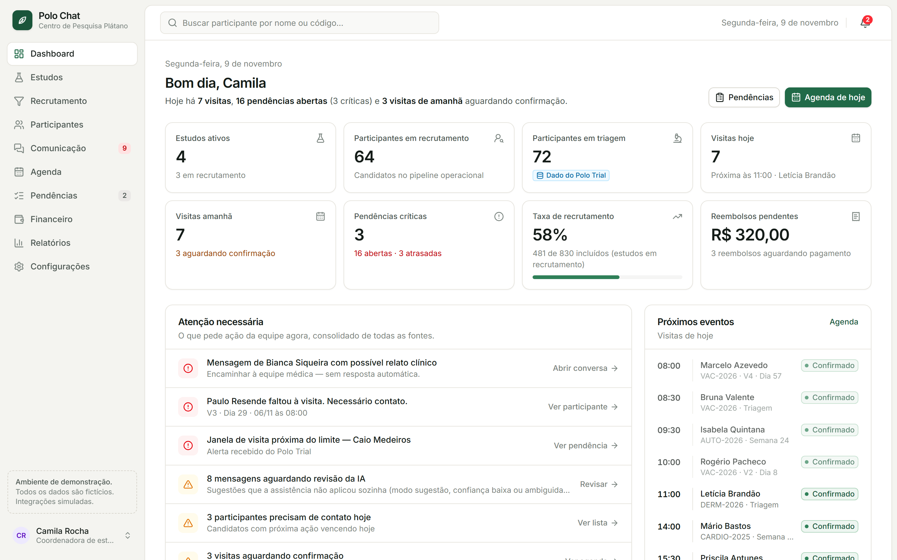
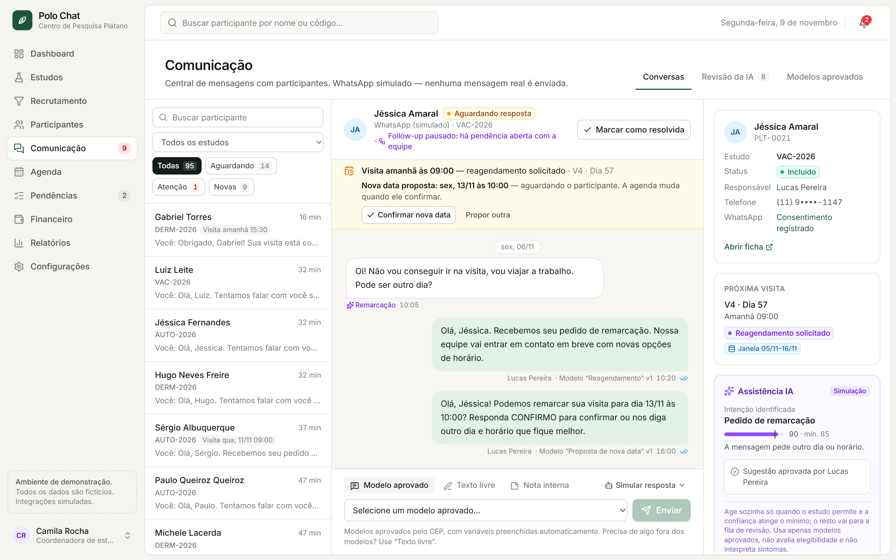
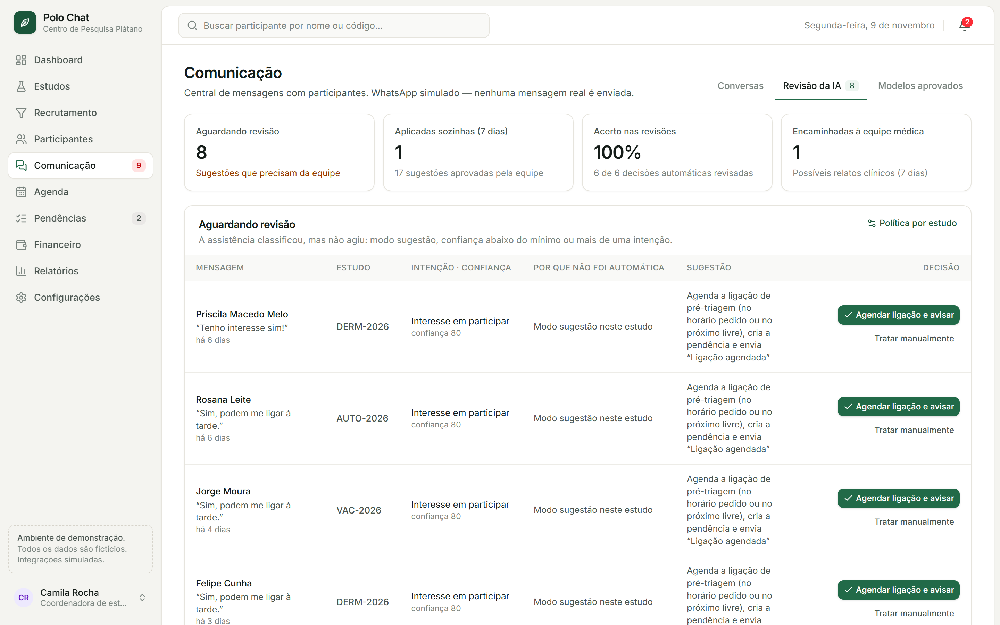
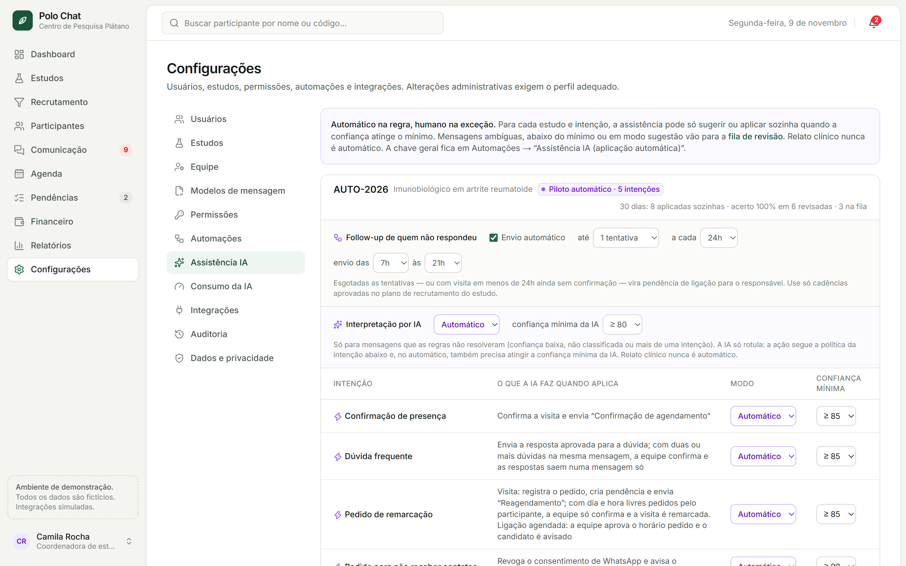
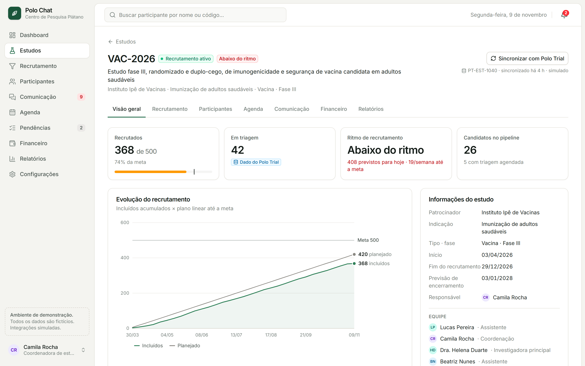
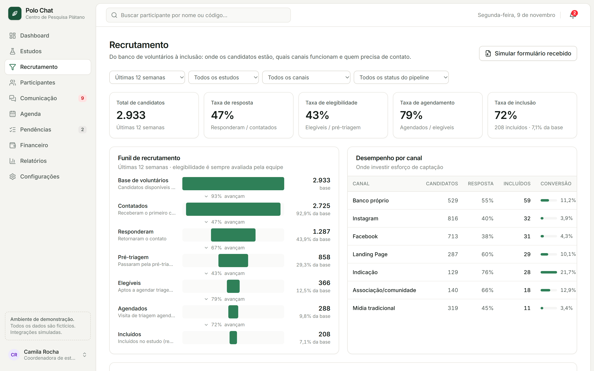
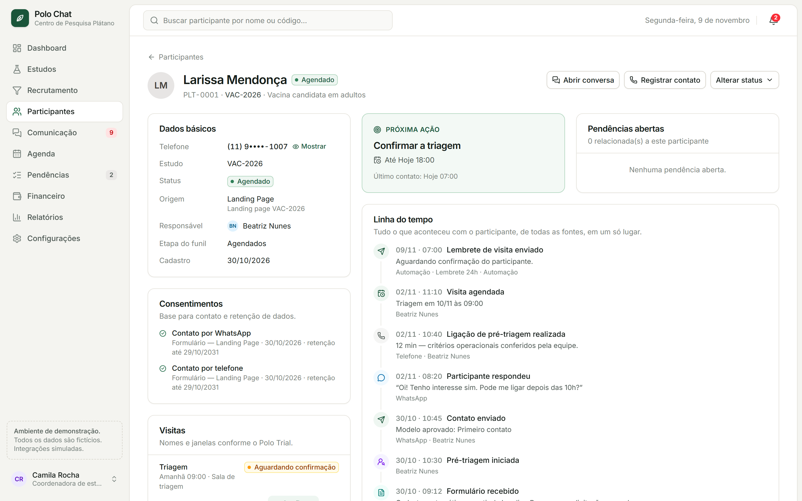
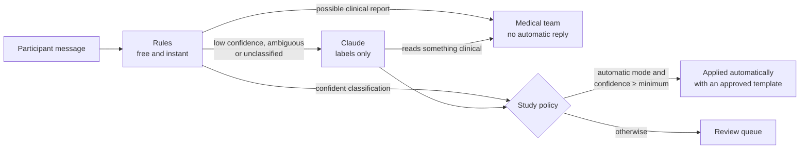

<div align="center">


# Polo Chat

**An operations layer for clinical research centers: WhatsApp, recruitment, scheduling and follow-ups in one place, with an AI that only acts on its own when it is safe to.**

[](https://github.com/PedroDhalia/polo-chat/actions/workflows/ci.yml)


[Português](README.md) · **English**

</div>



> [!NOTE]
> An independent project, not affiliated with Polo Trial or any company mentioned. **All data is fictitious** (the "Plátano Research Center" does not exist), and WhatsApp, Polo Trial, forms and finance are **simulated adapters**: no real message is ever sent. The interface and the detailed docs are in Brazilian Portuguese, since the product targets Brazilian research centers.

## The problem

A clinical research center runs several studies at once, and much of the day-to-day work happens outside any system: visit confirmations over WhatsApp, leads from web forms retyped by hand, follow-ups on people who didn't reply kept in someone's head, recruitment reports assembled in spreadsheets. Clinical and protocol data lives in the CTMS (here, Polo Trial). What gets lost is **the operation around it**: who needs a call, which visit is still unconfirmed, what to do next.

## The solution

Polo Chat **centralizes, organizes, automates and tracks** that operation, without replacing the CTMS. Visit windows and screening and enrollment counts come from Polo Trial and are only mirrored, never recalculated.

- **Daily dashboard:** a one-sentence summary and a *Needs attention* list consolidated from every source (no-shows, possible clinical reports, windows about to close, the AI review queue).
- **WhatsApp messaging:** only templates approved by the ethics committee, with variables filled in. Free text is reserved for staff, internal notes are available, and WhatsApp Business's 24-hour window is respected.
- **AI assistance, "automatic by rule, human by exception":** every reply is classified (confirmation, question, reschedule, opt-out, interest) with a 0–100 confidence score, and acts on its own only when the study's policy allows it. Everything else goes to a review queue.
- **Automations:** day-before reminders, follow-ups for unanswered messages (with attempt limits and sending hours), no-show → reschedule task, web form → new lead + task.
- **Rescheduling:** the new date must fit the Polo Trial window and the staff member's calendar, and the participant's confirmation is applied automatically.
- **Recruitment:** the full funnel, performance by channel, and enrollment pace versus target.
- **Role- and study-based access control**, a full audit trail, and purpose-specific consent.

## Screens

<table>
  <tr>
    <td width="50%"><br /><b>Conversation:</b> a reschedule request, a new date proposed within the Polo Trial window, and the AI's reading with its confidence.</td>
    <td width="50%"><br /><b>AI review:</b> what the AI left for the team and why, with one-click approval.</td>
  </tr>
  <tr>
    <td><br /><b>Per-study policy:</b> mode and minimum confidence per intent, follow-up cadence and sending hours.</td>
    <td><br /><b>Study:</b> enrolled versus target, recruitment pace and progress against the plan.</td>
  </tr>
  <tr>
    <td><br /><b>Recruitment:</b> funnel from volunteer base to enrollment, and conversion by channel.</td>
    <td><br /><b>Participant:</b> next action, consents and a timeline across every source.</td>
  </tr>
</table>

## How the AI decides



- **Rules first:** the LLM (Claude, through the Anthropic API) only sees what the rules could not resolve. This keeps cost under control, and usage is shown under *Configurações → Consumo da IA* (Settings → AI usage).
- **The AI only labels**, with structured output. The system takes the action, always with approved texts. The AI never decides eligibility, interprets adverse events or gives medical advice.
- **Prompt-injection defense:** participant text is treated as data, never as instructions, and the first name is replaced with `[nome]` before sending.
- **Runs without an API key:** by default `ASSIST_AI_MODE=mock`, a simulated AI at no cost that estimates the tokens a real call would use.

## Technical decisions

- **Layers with one job each:** Server Action (authorization and study scope) → domain service (changes data, writes the timeline and audit log) → automation engine (Event → Rule → Action) → screen revalidation. [Diagram](docs/arquitetura.md#fluxo-de-uma-ação).
- **Pure business rules in [`src/domain`](src/domain):** no database or framework, shared by server and browser. The AI's suggestion and the calendar shown in the conversation check conflicts with the same function, so they never disagree. All of them have unit tests.
- **Integrations behind contracts:** everything goes through `getIntegrations()`. The contracts describe what Polo Chat needs to receive, and **no Polo Trial endpoint was made up**. Swapping the mock for a real integration means writing an adapter.
- **Source of truth respected:** clinical and protocol data is only read from the CTMS, never recalculated or written back.
- **Deterministic dates:** everything in the center's time zone, identical on server and browser, and tests give the same result on any machine.
- **Realistic seed:** dates are relative to the day the seed runs and always on business days, so the demo is always "happening today".
- **Performance:** Server Components, automatic prefetch turned off (8 screens used to trigger 336 server renders without a single click), and a paginated conversation list. Each screen takes ~30 ms in production.

## Quality

| Check | What it covers |
| --- | --- |
| `npm run lint` | ESLint (Next core-web-vitals + TypeScript), zero warnings |
| `npm run typecheck` | TypeScript in `strict` mode |
| `npm test` | 62 unit tests (Vitest) for the domain rules: time slots, visit windows, scheduling conflicts, AI policy, RBAC |
| `npm run verify` | 100+ end-to-end checks of the main flows on an isolated database: automations, AI, rescheduling, permissions and auditing |
| [CI](.github/workflows/ci.yml) | All of the above, plus the build, on every push and pull request (AI always simulated) |

## Stack

Next.js 16 (App Router, Server Components, Server Actions) · React 19 · TypeScript · Tailwind CSS 4 · Prisma 6 + SQLite (portable to PostgreSQL) · Anthropic SDK · Vitest · ESLint · GitHub Actions. Charts are hand-written SVG, with no chart library.

## Running locally

Requirements: **Node.js 22.12+** and npm.

```bash
git clone https://github.com/PedroDhalia/polo-chat.git
cd polo-chat
npm install
cp .env.example .env    # on Windows (cmd): copy .env.example .env
npm run setup           # creates the SQLite database and loads the demo data
npm run demo            # production build at http://localhost:3000
```

No API key needed: the AI runs in simulated mode. To see access control in action, switch profiles in the menu at the bottom of the sidebar (*Financeiro*, for example, cannot see Communication). The [demo script](docs/demo.md) (in Portuguese) walks through the main flows in 5 minutes.

## Documentation (in Portuguese)

- [Demo script](docs/demo.md): what to show in 5 minutes, and ready-made scenarios in the seed.
- [Features and business rules](docs/funcionalidades.md): messaging, automations, rescheduling and AI assistance.
- [Architecture](docs/arquitetura.md): layers, data model, integrations, security and performance.
- [Integrations](src/integrations/README.md): contracts and how to add a real adapter.

## Next steps

- Real integrations: WhatsApp Business Platform and Polo Trial (based on the official API documentation).
- Real authentication (SSO/MFA) instead of the demo session.
- A scheduler (cron/queue) for the automations that currently run on *Executar ciclo* (Run cycle).
- PostgreSQL and an online demo.

Deliberately out of scope: eCRF, IRT/IWRS, medical records, source documents, and any clinical decision made by AI.

## Author

Built by **Pedro Dhalia** · [GitHub](https://github.com/PedroDhalia)

The code is public for review and portfolio purposes. All rights reserved: no license for reuse is granted.
