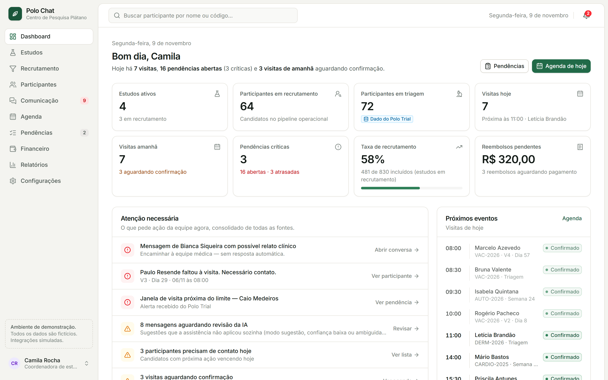
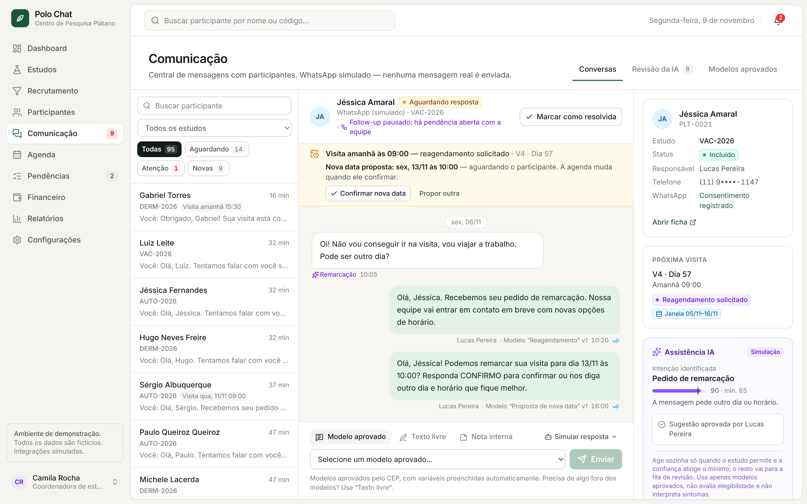
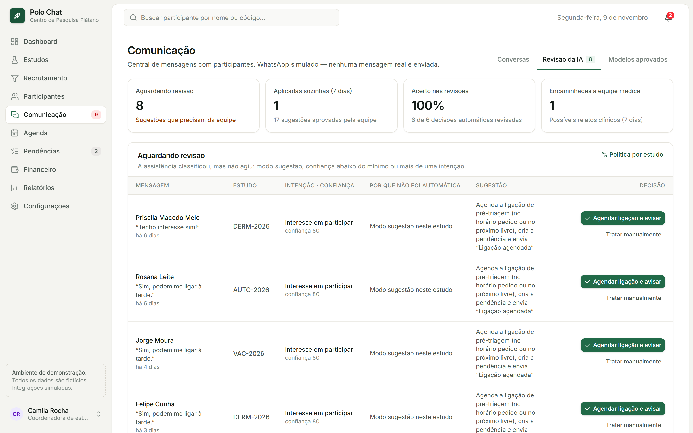
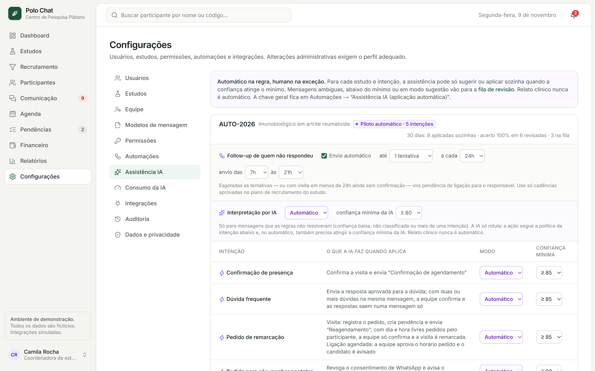
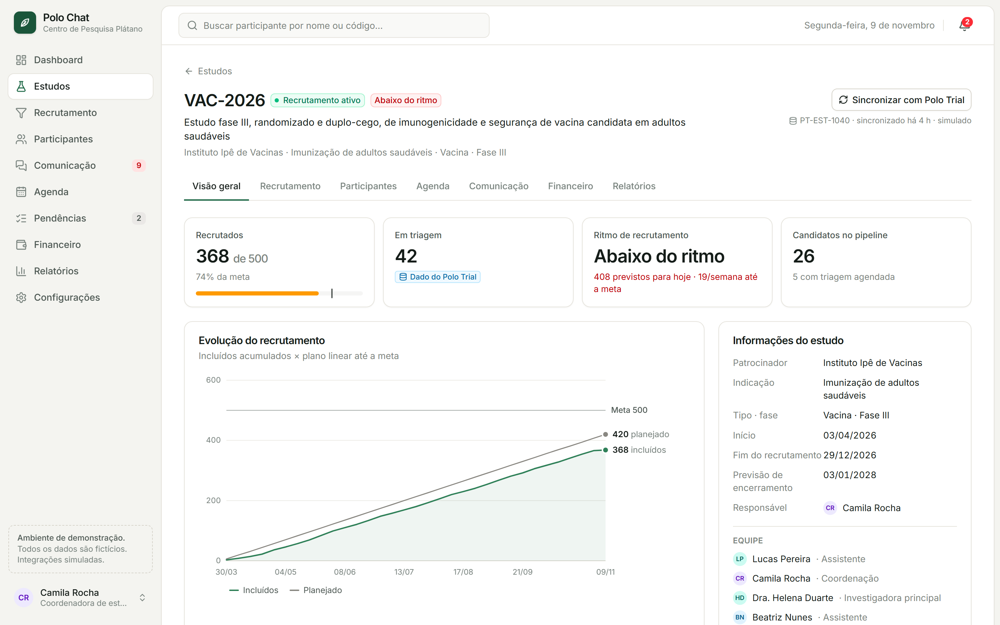
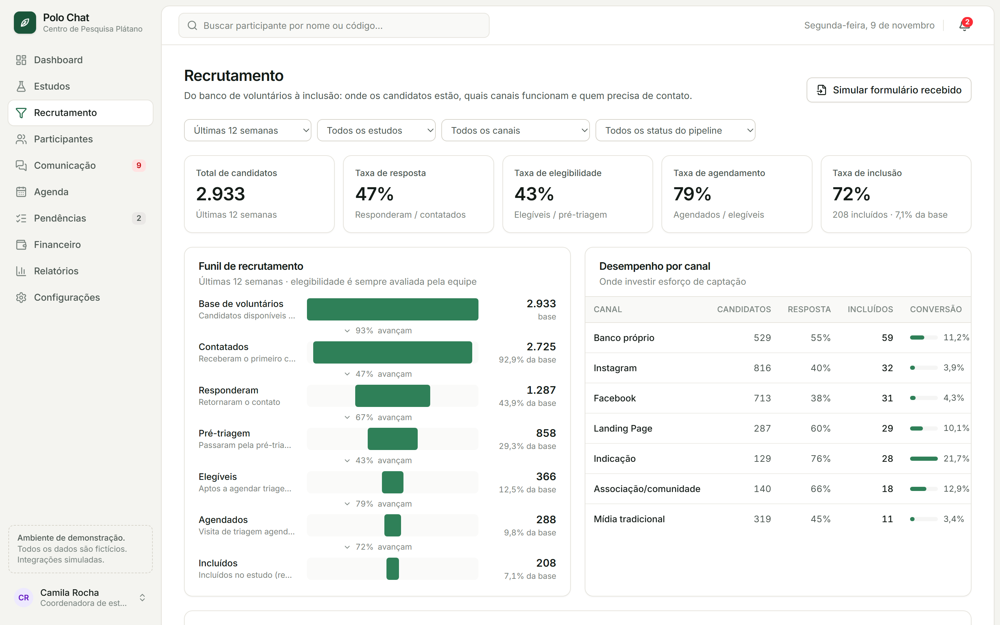
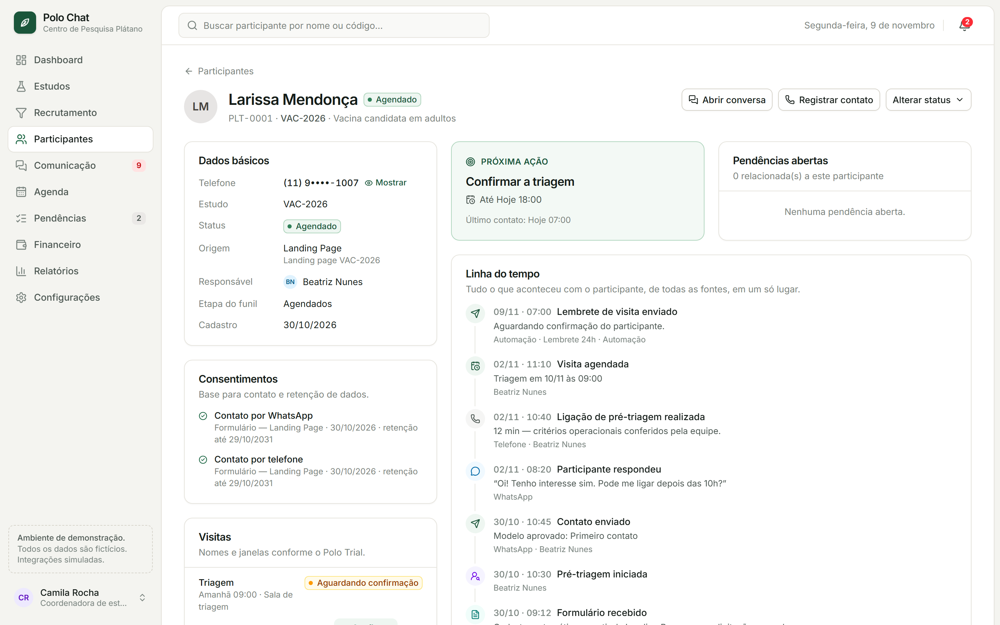
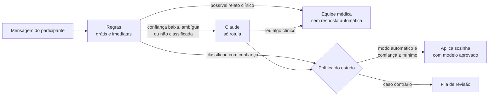

<div align="center">


# Polo Chat

**Camada operacional para centros de pesquisa clínica: WhatsApp, recrutamento, agenda e pendências num só lugar, com uma IA que só age sozinha quando é seguro.**

[](https://github.com/PedroDhalia/polo-chat/actions/workflows/ci.yml)


**Português** · [English](README.en.md)

</div>



> [!NOTE]
> Projeto independente, sem afiliação com o Polo Trial ou com qualquer empresa citada. **Todos os dados são fictícios** (o "Centro de Pesquisa Plátano" não existe), e WhatsApp, Polo Trial, formulários e financeiro são **adapters simulados**: nenhuma mensagem real é enviada.

## O problema

Um centro de pesquisa clínica conduz vários estudos ao mesmo tempo, e boa parte da operação acontece fora dos sistemas: confirmação de visita pelo WhatsApp, candidatos de formulário recadastrados à mão, follow-up de quem não respondeu lembrado de cabeça, relatório de recrutamento montado em planilha. Os dados clínicos e protocolares ficam no CTMS (aqui, o Polo Trial). O que se perde é **a operação em volta deles**: quem precisa de contato, qual visita está sem confirmação, o que fazer agora.

## A solução

O Polo Chat **centraliza, organiza, automatiza e acompanha** essa operação, sem substituir o CTMS. Janelas de visita e contagens de triagem e inclusão vêm do Polo Trial e são só espelhadas, nunca recalculadas.

- **Dashboard do dia:** uma frase-resumo e a lista *Atenção necessária*, consolidada de todas as fontes (faltas, possíveis relatos clínicos, janelas perto do limite, fila da IA).
- **Comunicação via WhatsApp:** só modelos aprovados pelo comitê de ética (CEP), com variáveis preenchidas. Texto livre é exclusivo da equipe, há notas internas e a janela de 24h do WhatsApp Business é respeitada.
- **Assistência IA, "automático na regra, humano na exceção":** classifica cada resposta (confirmação, dúvida, remarcação, descadastro, interesse) com confiança de 0 a 100 e só age sozinha quando a política do estudo permite. O resto vai para uma fila de revisão.
- **Automações:** lembrete na véspera, follow-up de quem não respondeu (com limite de tentativas e horário de envio), falta → reagendamento, formulário → candidato + pendência.
- **Remarcação:** a nova data respeita a janela do Polo Trial e a agenda do responsável, e a confirmação do participante é aplicada automaticamente.
- **Recrutamento:** funil completo, desempenho por canal e ritmo de inclusão × meta.
- **Controle de acesso por função e por estudo**, auditoria de tudo e consentimento por finalidade.

## Telas

<table>
  <tr>
    <td width="50%"><br /><b>Conversa:</b> pedido de remarcação, nova data proposta dentro da janela do Polo Trial e leitura da IA com confiança.</td>
    <td width="50%"><br /><b>Revisão da IA:</b> o que a IA deixou para a equipe e por quê, com aprovação em um clique.</td>
  </tr>
  <tr>
    <td><br /><b>Política por estudo:</b> modo e confiança mínima por intenção, follow-up e horário de envio.</td>
    <td><br /><b>Estudo:</b> incluídos × meta, ritmo de recrutamento e evolução contra o plano.</td>
  </tr>
  <tr>
    <td><br /><b>Recrutamento:</b> funil da base à inclusão e conversão por canal.</td>
    <td><br /><b>Participante:</b> próxima ação, consentimentos e linha do tempo de todas as fontes.</td>
  </tr>
</table>

## Como a IA decide



- **Regras primeiro:** o LLM (Claude, via API da Anthropic) só recebe o que as regras não resolveram. O custo fica controlado e aparece em *Configurações → Consumo da IA*.
- **A IA só rotula**, com saída estruturada. Quem age é o sistema, sempre com textos aprovados. Ela não decide elegibilidade, não interpreta eventos adversos e não dá orientação médica.
- **Defesa contra prompt injection:** o texto do participante é tratado como dado, nunca como instrução, e o primeiro nome é trocado por `[nome]` antes do envio.
- **Roda sem chave:** por padrão `ASSIST_AI_MODE=mock`, uma IA simulada, sem custo, que estima os tokens de uma chamada real.

## Decisões técnicas

- **Camadas com uma responsabilidade cada:** Server Action (autorização e escopo do estudo) → serviço de domínio (altera, grava linha do tempo e auditoria) → motor de automações (Evento → Regra → Ação) → revalidação da tela. [Diagrama](docs/arquitetura.md#fluxo-de-uma-ação).
- **Regras de negócio puras em [`src/domain`](src/domain):** sem banco nem framework, usadas no servidor e no navegador. A sugestão da IA e a agenda exibida na conversa checam conflitos com a mesma função, então nunca divergem. Todas têm testes unitários.
- **Integrações atrás de contratos:** tudo passa por `getIntegrations()`. Os contratos descrevem o que o Polo Chat precisa receber, e **nenhum endpoint do Polo Trial foi inventado**. Trocar o mock pela integração real é escrever um adapter.
- **Fonte da verdade respeitada:** dados clínicos e protocolares só são lidos do CTMS, nunca recalculados nem escritos de volta.
- **Datas determinísticas:** tudo no fuso do centro, idêntico no servidor e no navegador, com o mesmo resultado dos testes em qualquer máquina.
- **Seed realista:** datas relativas ao dia em que o seed roda e sempre em dias úteis, então a demonstração está sempre "acontecendo hoje".
- **Desempenho:** Server Components, prefetch automático desligado (8 telas disparavam 336 renderizações sem nenhum clique) e lista de conversas paginada. Cada tela leva ~30 ms em produção.

## Qualidade

| Verificação | O que cobre |
| --- | --- |
| `npm run lint` | ESLint (Next core-web-vitals + TypeScript), sem nenhum aviso |
| `npm run typecheck` | TypeScript em modo `strict` |
| `npm test` | 62 testes unitários (Vitest) das regras de domínio: horários, janelas, conflitos de agenda, política da IA, RBAC |
| `npm run verify` | Mais de 100 verificações dos fluxos completos num banco isolado: automações, IA, remarcação, permissões e auditoria |
| [CI](.github/workflows/ci.yml) | Tudo acima, mais o build, a cada push e pull request (IA sempre simulada) |

## Stack

Next.js 16 (App Router, Server Components, Server Actions) · React 19 · TypeScript · Tailwind CSS 4 · Prisma 6 + SQLite (portável para PostgreSQL) · Anthropic SDK · Vitest · ESLint · GitHub Actions. Os gráficos são SVG próprio, sem biblioteca.

## Como rodar

Requisitos: **Node.js 22.12+** e npm.

```bash
git clone https://github.com/PedroDhalia/polo-chat.git
cd polo-chat
npm install
cp .env.example .env    # no Windows (cmd): copy .env.example .env
npm run setup           # cria o banco SQLite e carrega os dados de demonstração
npm run demo            # build de produção em http://localhost:3000
```

Não precisa de chave de API: a IA roda simulada. Para ver o controle de acesso, troque o perfil no menu inferior da barra lateral (o *Financeiro*, por exemplo, não vê Comunicação). O [roteiro de demonstração](docs/demo.md) mostra os fluxos principais em 5 minutos.

| Comando | O que faz |
| --- | --- |
| `npm run demo` | Gera e abre a versão de produção |
| `npm run dev` | Servidor de desenvolvimento |
| `npm run db:reset` | Recarrega os dados de demonstração (datas relativas a hoje) |
| `npm test` / `npm run verify` | Testes unitários / fluxos completos |
| `npm run lint` / `npm run typecheck` | Lint / checagem de tipos |

## Documentação

- [Roteiro de demonstração](docs/demo.md): o que mostrar em 5 minutos e cenários prontos no seed.
- [Funcionalidades e regras de negócio](docs/funcionalidades.md): mensagens, automações, remarcação e assistência IA.
- [Arquitetura](docs/arquitetura.md): camadas, modelo de dados, integrações, segurança e desempenho.
- [Integrações](src/integrations/README.md): contratos e como adicionar um adapter real.

## Próximos passos

- Integrações reais: WhatsApp Business Platform e Polo Trial (a partir da documentação oficial da API).
- Autenticação real (SSO/MFA) no lugar da sessão de demonstração.
- Agendador (cron/fila) para as automações que hoje rodam em *Executar ciclo*.
- PostgreSQL e demo online.

Fica fora do escopo de propósito: eCRF, IRT/IWRS, prontuário, source documents e qualquer decisão clínica por IA.

## Autor

Feito por **Pedro Dhalia** · [GitHub](https://github.com/PedroDhalia)

O código está público para avaliação e portfólio. Todos os direitos reservados: não há licença de reutilização.
