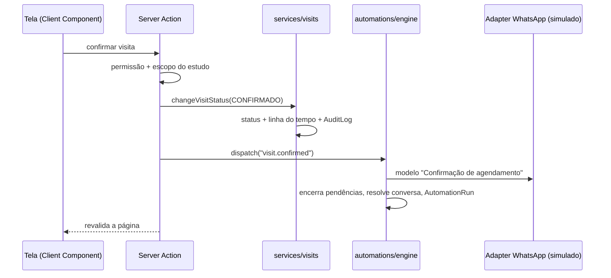

# Arquitetura

[← Voltar ao README](../README.md)

**Stack:** Next.js 16 (App Router, Server Components e Server Actions), React 19, TypeScript, Tailwind CSS 4, Prisma 6 e SQLite. Os gráficos são SVG/HTML próprios, sem biblioteca extra.

```
prisma/schema.prisma        modelo de dados (portável para PostgreSQL)
prisma/seed.ts              carrega src/server/demo/seed.ts
src/app/(app)/              páginas: dashboard, estudos, recrutamento, participantes,
                            comunicação, agenda, pendências, financeiro, relatórios, configurações
src/components/ui|charts|layout   primitivos visuais, gráficos e shell
src/features/<área>/        composições por área (tabelas, listas, painéis)
src/domain/                 vocabulário e regras puras: rótulos, permissões (RBAC), ritmo, modelos,
                            política da assistência, horários de ligação e visita, janela de visita
                            (*.test.ts ao lado de cada regra)
src/lib/                    datas no fuso do centro, formatação
src/server/
  auth/session.ts           sessão de demonstração + escopo por estudo
  queries/                  leituras (sempre filtradas pelo escopo do usuário)
  actions/                  server actions: autorização → serviço → automação → revalidação
  services/                 operações de domínio + auditoria + linha do tempo
  automations/              regras (Evento → Regra → Ação) e motor
  ai/assist.ts              assistência: regras + segunda opinião da IA
  demo/seed.ts              dados fictícios determinísticos
src/integrations/           contratos + adapters: polo-trial, whatsapp, forms, finance, ai
scripts/verify-flows.ts     verificação dos fluxos principais (banco isolado)
.github/workflows/ci.yml    lint, tipos, testes, fluxos e build a cada push
```

## Fluxo de uma ação

Exemplo: confirmar visita.



## Modelo de dados

Entidades: `User`, `StudyMember`, `Study`, `Participant`, `Recruitment`, `RecruitmentStage`, `RecruitmentMetric`, `ConsentRecord`, `Visit`, `Conversation`, `Communication`, `MessageTemplate`, `Task`, `Reimbursement`, `FinancialRecord`, `TimelineEvent`, `AuditLog`, `Notification`, `ExternalReference`, `AutomationRule`, `AutomationRun`, `StudyAutomationSettings`, `AssistPolicy`, `AssistDecision`, `AiUsage`.

- **Separação por estudo:** todos os registros operacionais têm `studyId`. O acesso é recortado por `StudyMember`, e Diretor, Financeiro e Qualidade têm acesso transversal.
- **Fonte externa:** `Study.enrolledCount/screeningCount` e `Visit.windowStart/windowEnd` são snapshots do Polo Trial. `ExternalReference` mapeia IDs externos sem acoplar o modelo a uma API.
- **Migrar para PostgreSQL:** troque `provider = "sqlite"` por `"postgresql"` em `prisma/schema.prisma` e ajuste `DATABASE_URL`. Valores monetários ficam em centavos (`Int`) e os enums são nativos do Prisma. As buscas textuais usam `contains`, que em PostgreSQL diferencia maiúsculas; adicione `mode: "insensitive"` nas consultas.

## Integrações

Veja [`src/integrations/README.md`](../src/integrations/README.md). Nenhuma parte do sistema fala com um sistema externo diretamente: tudo passa por `getIntegrations()`. **Nenhum endpoint do Polo Trial foi assumido.** Os contratos descrevem o que o Polo Chat precisa receber, e o adapter real será escrito a partir da documentação oficial.

## Datas

Todas as datas são interpretadas no fuso do centro (America/Sao_Paulo), em [`src/lib/dates.ts`](../src/lib/dates.ts): a renderização é idêntica no servidor e no navegador, e os testes dão o mesmo resultado em qualquer fuso de máquina. O seed gera datas relativas ao dia em que roda, sempre em dias úteis.

## Segurança e privacidade (preparação, não conformidade)

O MVP **não declara conformidade com a LGPD**. A arquitetura já prevê:
- controle de acesso por função e por estudo;
- telefone mascarado, com exibição auditada;
- e-mail não armazenado;
- consentimento por finalidade, com origem, revogação e prazo de retenção, e envio bloqueado sem consentimento;
- trilha de auditoria para pessoas, automações e integrações.

Pendentes para fases futuras: autenticação real (SSO/MFA), retenção automatizada, anonimização, direitos do titular, criptografia em repouso e avaliação jurídica.

## Desempenho

- **Produção:** com `npm run demo`, cada tela responde em ~30 ms e o servidor usa ~120 MB de RAM.
- **Sem prefetch automático:** todos os links usam [`src/components/ui/link.tsx`](../src/components/ui/link.tsx) (`prefetch={false}`). Antes, abrir e rolar 8 telas disparava 336 renderizações no servidor sem nenhum clique.
- **Comunicação:** a lista mostra 40 conversas por vez ("Carregar mais") e envia só o início de cada mensagem.
- **Cache do modo desenvolvimento desligado:** `next.config.ts` desativa `turbopackFileSystemCacheForDev`, que chegava a ~500 MB em `.next/dev` e era regravado a cada alteração. Pode ser reativado para reinícios mais rápidos, se o projeto não estiver numa pasta sincronizada (OneDrive, Dropbox).
- **Pasta sincronizada:** `node_modules` (~20 mil arquivos) e `.next` não precisam ser sincronizados. Prefira manter o projeto fora do OneDrive/Dropbox ou pausar a sincronização enquanto usa o sistema.

## Fora do escopo deste MVP

eCRF, IRT/IWRS, prontuário, source documents, assinatura digital, integrações reais (Polo Trial, WhatsApp, ZapCloud, Google Forms, financeiro), decisões clínicas por IA, automação clínica autônoma, funcionalidades GCP críticas e aplicativo mobile.
